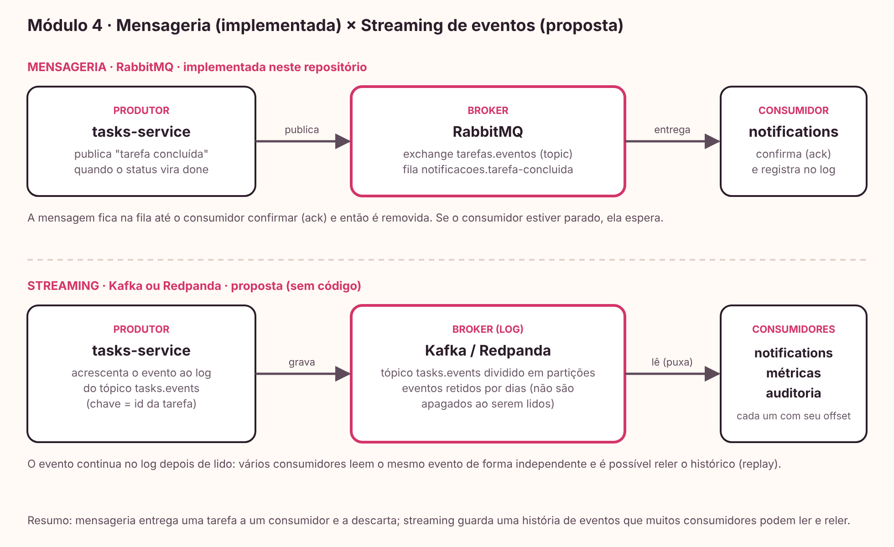

# Mensageria × streaming de eventos: o caso "tarefa concluída"

**O cenário.** Quando uma tarefa é concluída, o `tasks-service` precisa avisar o resto do sistema. **Implementado:** ele publica o evento no RabbitMQ e o serviço `notifications` o recebe e confirma no log. **Proposto (sem código):** o mesmo cenário com um serviço de streaming, Kafka ou Redpanda.

**Como funciona hoje (mensageria).** O RabbitMQ é como um correio. O produtor entrega a mensagem a uma *exchange*, que a coloca em uma *fila*. O consumidor recebe, processa e confirma (*ack*); só então a mensagem **é removida**. Se o consumidor está parado, a mensagem espera na fila. O broker *empurra* as mensagens para quem está ligado a ela.

**O que mudaria com streaming (Kafka/Redpanda).**
- O evento vira um registro em um **log**: o tópico `tasks.events`, dividido em partições, com a **chave = id da tarefa** (isso mantém a ordem dos eventos de uma mesma tarefa).
- O evento **não é apagado ao ser lido**: fica **retido** (por exemplo, 7 dias). Cada consumidor guarda a sua posição (*offset*) e **puxa** os eventos no seu ritmo.
- O produtor passaria a publicar **todas** as mudanças de estado (criada, iniciada, concluída, reaberta), e não só "concluída".

**Quem seriam os consumidores.** Grupos independentes, cada um lendo o mesmo tópico sem atrapalhar os outros: `notifications` (avisa o responsável), `métricas` (painel de produtividade: tarefas concluídas por dia e por projeto) e `auditoria` (histórico imutável de mudanças). Um novo consumidor, como um índice de busca, poderia ser adicionado depois e começar relendo o histórico.

| Aspecto | Mensageria (RabbitMQ, implementada) | Streaming (Kafka/Redpanda, proposta) |
|---|---|---|
| Modelo | Fila: a mensagem vai para um consumidor e é removida após o ack | Log: o evento fica retido e cada consumidor lê pelo seu offset |
| Vários consumidores do mesmo evento | Cada consumidor precisa da sua própria fila ligada à exchange | Nativo: grupos de consumidores leem o mesmo log |
| Reprocessar o histórico (replay) | Não: a mensagem some depois do ack | Sim, enquanto o evento estiver retido |
| Ordem dos eventos | Por fila; enfraquece com vários consumidores na mesma fila | Garantida dentro de cada partição (chave = tarefa) |
| Foco | Entrega confiável e roteamento flexível | Alto volume e processamento contínuo de eventos |
| Operação | Simples: um container e o painel de administração | Mais pesada: partições, retenção, offsets |

**Quando o streaming se justificaria mais do que a mensageria.**
1. Quando **vários serviços** precisarem do mesmo evento (notificações, métricas, auditoria, busca) e novos consumidores surgirem com o tempo.
2. Quando for preciso **reprocessar o histórico**: recalcular métricas, corrigir um erro de um consumidor ou alimentar um serviço novo com os eventos antigos.
3. Quando o **volume** de eventos crescer muito (muitos usuários e tarefas).
4. Quando for preciso **processamento contínuo**, como "tarefas concluídas na última hora" (agregações por janela de tempo), ou usar os eventos como fonte da verdade.

**Para o nosso sistema hoje, a mensageria é a escolha certa:** há um único consumidor simples e baixo volume, e o RabbitMQ resolve isso com menos peças e uma operação mais simples. O streaming passaria a valer a pena quando surgissem os consumidores de métricas e auditoria, ou a necessidade de reler o histórico.

## Limites da implementação atual

- O `tasks-service` publica **sem confirmação do broker** (*publisher confirms*) e **depois** de gravar no banco. Se o RabbitMQ cair exatamente nesse intervalo, o evento se perde (o erro é registrado no log). A solução em produção é o padrão **outbox**: gravar o evento no próprio banco, na mesma transação, e um processo à parte publicá-lo.
- A entrega é **pelo menos uma vez**: se o consumidor cair depois de processar e antes do ack, a mensagem é reentregue. Por isso cada evento carrega um `event_id`, que permitiria ao consumidor ignorar repetições (idempotência).
